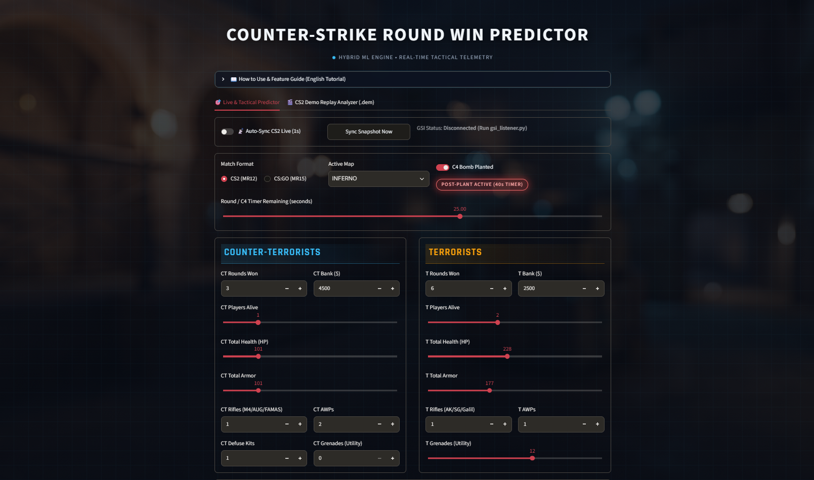

# CS2 / CS:GO Tactical Round Win Predictor

A hybrid machine learning and deterministic game-engine telemetry dashboard that predicts Counter-Terrorist vs. Terrorist round win probabilities in real time.


## Key Features
- **Hybrid ML + Game-Rules Engine:** Combines a `RandomForestClassifier` trained on 122,410 competitive round snapshots with exact Counter-Strike timing guardrails (`3.2s` C4 plant threshold, `5.0s` kit defuse, `10.0s` non-kit defuse).
- **Full Loadout & Economy Modeling:** Evaluates active rifles, AWPs, total armor, grenade utility, player differentials, health pools, and unspent team bank.
- **CS2 MR12 & CS:GO MR15 Support:** Scales CS2 MR12 round scores to match the MR15 training distribution.
- **Live CS2 Game State Integration (GSI):** Receives live HTTP JSON telemetry directly from Counter-Strike 2 via `gsi_listener.py`.
- **CS2 Demo Replay Analyzer (`.dem`):** Parses uploaded match demos via `demoparser2` to plot full-match win probability timelines and highlight top clutch/comeback rounds.

## Project Structure
```text
cs2predict/
├── assets/
│   ├── background.jpg
│   └── style.css
├── data/
│   └── csgo_round_snapshots.csv
├── models/
│   └── csgo_model.joblib
├── app.py
├── demo_analyzer.py
├── gsi_listener.py
├── predict.py
├── train.py
├── requirements.txt
├── README.md
└── .gitignore
```

## Quick Start

1. **Install dependencies:**
   ```bash
   pip install -r requirements.txt
   ```

2. **Train the model** (place `csgo_round_snapshots.csv` inside `data/`):
   ```bash
   python train.py
   ```

3. **Launch the Tactical HUD dashboard:**
   ```bash
   streamlit run app.py
   ```

4. *(Optional)* **Connect live to CS2:** Copy `gamestate_integration_winpredictor.cfg` into your CS2 `game/csgo/cfg/` folder and run:
   ```bash
   python gsi_listener.py
   ```